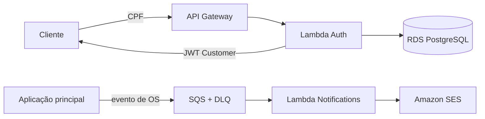

# Oficina Mecânica — Serverless

> Fase 4: a autenticação passou a consultar o OS Service por HTTP. Configure CustomerApiUrl/CUSTOMER_API_URL apontando para POST /internal/auth/customers e InternalApiKey/INTERNAL_API_KEY com o mesmo segredo Internal__Key do OS. O acesso direto ao PostgreSQL foi removido do código; referências antigas a DATABASE_URL neste README pertencem à Fase 3 e não devem ser usadas no novo deploy.

Repositório das duas funções serverless independentes da solução: autenticação de clientes por CPF e envio assíncrono de notificações de ordens de serviço.

## Arquitetura



`functions/auth` valida o CPF, consulta `tb_customers.is_active` e emite JWT HS256 com `sub`, `cpf` e `role=Customer`. `functions/notifications` consome eventos SQS, suporta resposta parcial de lote e envia e-mail pelo SES. `template-auth.yaml` e `template-notifications.yaml` geram stacks e deploys independentes. A Lambda Auth deve receber sub-redes privadas e security group com acesso ao RDS.

## Execução e testes

Pré-requisitos: Node.js 22, npm, AWS SAM CLI e Docker.

```bash
npm ci
npm test
sam validate --lint --template-file template-auth.yaml
sam validate --lint --template-file template-notifications.yaml
sam build --template-file template-auth.yaml
```

Para execução local, copie `samconfig.toml.example`, defina `DATABASE_URL`, `JWT_KEY` (mínimo de 32 caracteres) e `FROM_EMAIL`, e use `sam local start-api`. Nunca versione esses segredos.

## Deploy

Pull requests executam testes e `sam build`. Merge em `main` assume a role indicada em `AWS_DEPLOY_ROLE_ARN` por OIDC e faz deploy automático. Configure também os secrets `DATABASE_URL`, `JWT_KEY` e a variável `FROM_EMAIL`. A identidade remetente deve estar validada no SES.

Para simplificar a entrega acadêmica, foi adotado um único ambiente (produção).
